# 🛡️ Monitoreo SNMP con Zabbix y DHCP en Router y Switch Cisco

**Albert Euclides Garcia — Matrícula 2025-2241 (`20252241`)**


> Un router Cisco reparte direcciones por **DHCP** a la red LAN. El router y el switch publican **SNMP de solo lectura**, y un servidor **Zabbix**, que recibe su dirección por DHCP, consulta a ambos equipos y muestra sus datos de monitoreo.

---

## 📺 Video de Demostración

> [**Ver demostración en YouTube →**](https://www.youtube.com/watch?v=S5Om3JqiAEA)

---

## 📑 Tabla de Contenido

1. [Propósito del Laboratorio](#-propósito-del-laboratorio)
2. [Cumplimiento de Requisitos](#-cumplimiento-de-requisitos)
3. [Direccionamiento IP basado en la matrícula](#-direccionamiento-ip-basado-en-la-matrícula)
4. [Parámetros Usados](#-parámetros-usados)
5. [Documentación de la Red](#-documentación-de-la-red)
6. [Funcionamiento de la Configuración](#-funcionamiento-de-la-configuración)
7. [Validación de la Implementación](#-validación-de-la-implementación)
8. [Scripts](#-scripts)
9. [Estructura del Repositorio](#-estructura-del-repositorio)

---

## 🎯 Propósito del Laboratorio

Demostrar la **monitorización segura** de equipos de red mediante SNMP y un servidor Zabbix, aplicando estas políticas:

- El **router** entrega direcciones IP a la LAN con un servidor **DHCP**, de modo que los equipos de la red obtienen su configuración sin asignarla a mano.
- El router y el switch exponen **SNMP con una comunidad de solo lectura (RO)**: el servidor de monitoreo puede consultar el estado de los equipos, pero **no puede modificar** su configuración.
- El acceso SNMP se **limita con una lista de acceso (ACL)** a la red de la infraestructura (`10.22.41.0/24`).
- El servidor **Zabbix** es **cliente DHCP**: recibe su dirección del router y, con ella, recopila los datos SNMP del router y del switch.
- Los datos recopilados (modelo, CPU, memoria, temperatura, estado y tráfico de las interfaces, latencia) se **verifican en la interfaz web de Zabbix**.

---

## ✅ Cumplimiento de Requisitos

| Requisito | Implementado con |
|---|---|
| Repositorio de GitHub con documentación profesional | Este repositorio |
| Video demostrativo al principio del repositorio | Sección [Video de Demostración](#-video-de-demostración) |
| Documentación con imágenes y diagramas | Carpeta `image/` y diagramas Mermaid en [Documentación de la Red](#-documentación-de-la-red) |
| Propósito del laboratorio | Sección [Propósito del Laboratorio](#-propósito-del-laboratorio) |
| Todos los scripts utilizados | Carpeta [`scripts/`](scripts) |
| Running-configs | Carpeta [`running-configs/`](running-configs) |
| Direccionamiento IP en router y switch | `R1-2241` Fa0/0 `10.22.41.1/24` y `SW1-2241` VLAN 1 `10.22.41.2/24` |
| Servidor DHCP para la red LAN | Pool `LAN-2241` en `R1-2241` (`10.22.41.0/24`, rango entregado `10.22.41.50 – 10.22.41.200`) |
| Comunidad SNMP de solo lectura | `snmp-server community <comunidad-snmp> RO 10` en `R1-2241` y `SW1-2241` |
| Zabbix como cliente DHCP | Interfaz `ens3` del servidor con `dhcp4: true` (netplan), con IP entregada por el router |
| Verificar en Zabbix los datos SNMP del router y del switch | Equipos `R1-2241` y `SW1-2241` con SNMP disponible y datos en *Monitorización > Datos más recientes* |
| Direccionamiento basado en la matrícula | Red `10.22.41.0/24`, derivada de los dígitos `22` y `41` de la matrícula |

---

## 🧮 Direccionamiento IP basado en la matrícula

### 1. Origen de las direcciones

Mi matrícula es **2025-2241** (`20252241`). Tomé sus últimos cuatro dígitos, `2241`, separados en dos pares, **`22`** y **`41`**:

| Dígitos de la matrícula | Dónde se usan | Ejemplo |
|---|---|---|
| `22` → segundo octeto | Red privada de la infraestructura | 10.**22**.41.0 |
| `41` → tercer octeto | Red privada de la infraestructura | 10.22.**41**.0 |

### 2. Red utilizada

Una sola red LAN compartida por el router, el switch y el servidor, así que un prefijo /24 es suficiente:

| Segmento | Prefijo | Máscara | Hosts útiles | Red | Rango utilizable | Broadcast |
|---|---|---|---|---|---|---|
| LAN | /24 | 255.255.255.0 | 254 | 10.22.41.0 | 10.22.41.1 – 10.22.41.254 | 10.22.41.255 |

**Cálculo del prefijo:** 32 − 24 = 8 bits de host → 2⁸ = 256 direcciones → 254 hosts útiles.

### 3. Asignación de direcciones

| Dispositivo | Interfaz | IP | Asignación |
|---|---|---|---|
| R1-2241 (router y servidor DHCP) | FastEthernet0/0 | 10.22.41.1/24 | Estática |
| SW1-2241 (switch) | VLAN 1 (SVI) | 10.22.41.2/24 | Estática |
| ZABBIX-2241 (servidor) | ens3 | 10.22.41.x/24 (entre .50 y .200) | **DHCP** |
| PC de administración (Windows) | VMware Network Adapter VMnet1 | 10.22.41.210/24 | Estática, IP adicional para abrir la web de Zabbix |

### 4. Reparto de direcciones por DHCP

| Rango | Uso |
|---|---|
| 10.22.41.1 – 10.22.41.49 | **Excluido** del DHCP (equipos con IP fija: router `.1` y switch `.2`) |
| 10.22.41.50 – 10.22.41.200 | **Entregado por DHCP** (clientes, entre ellos el servidor Zabbix) |
| 10.22.41.201 – 10.22.41.254 | **Excluido** del DHCP (reservado; la PC de administración usa `.210`) |

**Evidencia:**

Adaptadores de red de la máquina virtual de GNS3 (adaptador 1 en Solo host, usado por el nodo Cloud, y adaptador 2 en NAT):

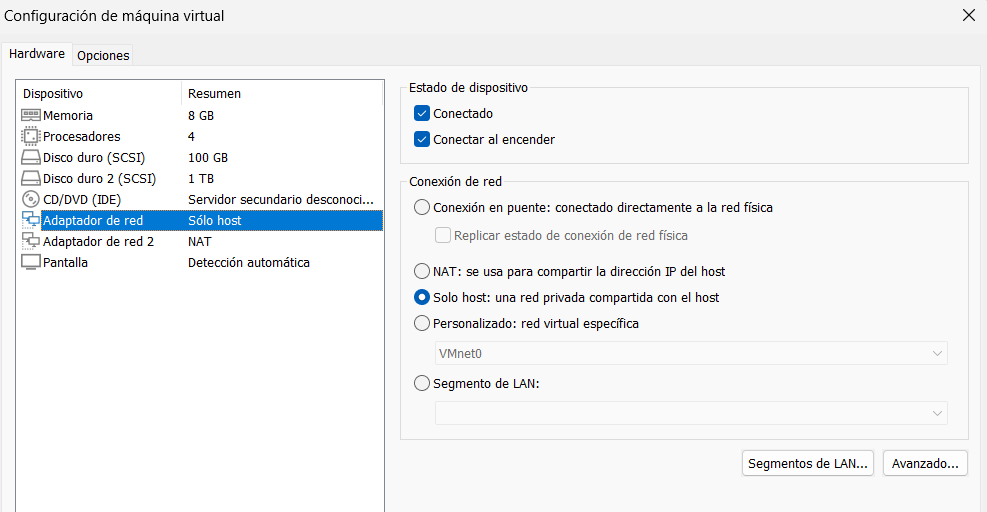

IP adicional de la PC de administración y conectividad hacia el router:

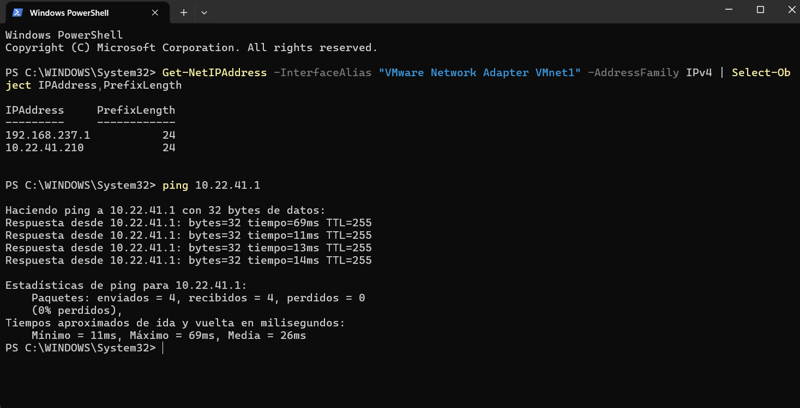

---

## 🧩 Parámetros Usados

| Parámetro | Valor |
|---|---|
| Router | Cisco 7200 (`R1-2241`), modelo reportado por SNMP: `CISCO7206VXR` |
| Switch | Cisco IOSvL2 (`SW1-2241`), plantilla QEMU de GNS3 |
| Servidor de monitoreo | Ubuntu Server 26.04 como nodo QEMU de GNS3 (`ZABBIX-2241`) |
| Software de monitoreo | Zabbix 7.0.22 (paquetes del repositorio de Ubuntu), MariaDB, Apache y PHP 8.5 |
| Emulador | GNS3 con GNS3 VM sobre VMware Workstation |
| Enlace con la PC de administración | Nodo `Cloud` con la interfaz `eth0` de la GNS3 VM (adaptador 1, Solo host) ↔ `VMware Network Adapter VMnet1` en Windows |
| DHCP | Pool `LAN-2241`: red `10.22.41.0/24`, gateway `10.22.41.1`, DNS `8.8.8.8`, concesión de 7 días |
| SNMP | Versión 2c, comunidad de **solo lectura (RO)**, limitada con la ACL 10 (`10.22.41.0/24`), puerto UDP 161 |
| Datos de contacto SNMP | Ubicación `ITLA-Lab-2241` y contacto `AlbertGarcia-2241` |
| Plantilla de Zabbix | `Cisco IOS by SNMP` (también para el switch) |
| Grupo de equipos en Zabbix | `Red-2241` |
| Equipos monitoreados | `R1-2241` (`10.22.41.1`) y `SW1-2241` (`10.22.41.2`) |

> La comunidad SNMP no se publica en este repositorio y aparece como `<comunidad-snmp>`.

---

## 📡 Documentación de la Red

### Topología

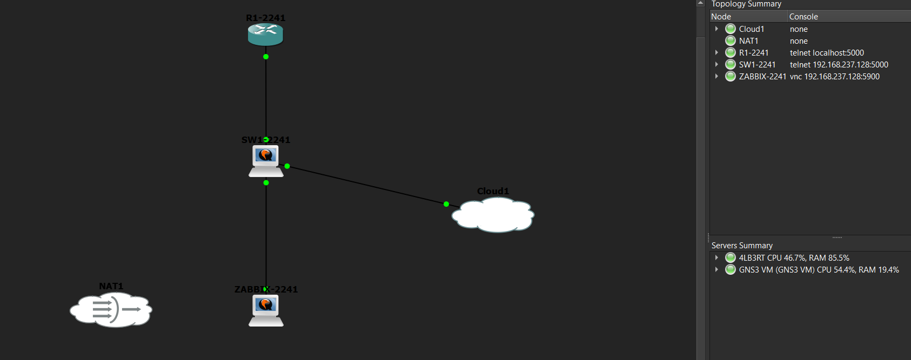

### Conexiones físicas

| Origen | Destino |
|---|---|
| `R1-2241` FastEthernet0/0 | `SW1-2241` GigabitEthernet0/0 |
| `SW1-2241` GigabitEthernet0/1 | `ZABBIX-2241` e0 (`ens3`) |
| `SW1-2241` GigabitEthernet1/3 | `Cloud` eth0 (acceso desde la PC de administración) |

### Diagrama lógico

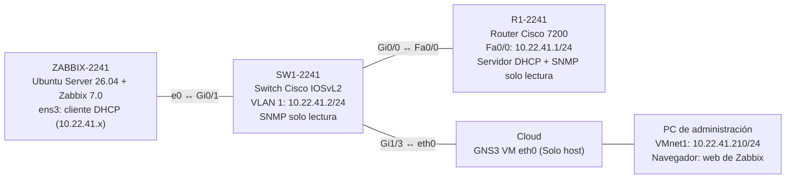

### Diagrama de DHCP

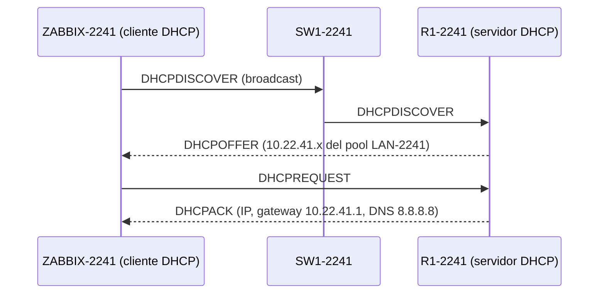

### Diagrama de monitoreo SNMP

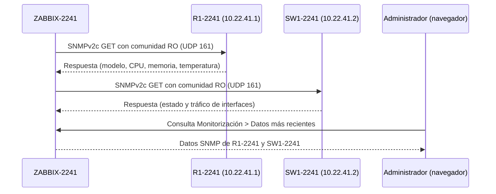

---

## 🔬 Funcionamiento de la Configuración

**DHCP:** el router `R1-2241` tiene el pool `LAN-2241` para la red `10.22.41.0/24`. Se excluyeron las direcciones `.1` a `.49` (equipos con IP fija) y `.201` a `.254` (reservadas), por lo que los clientes reciben direcciones entre `.50` y `.200`, con el router como gateway y `8.8.8.8` como DNS. El servidor Zabbix tiene su interfaz `ens3` configurada como cliente DHCP, así que recibe su dirección de este pool.

**SNMP de solo lectura:** el router y el switch tienen una comunidad `RO`. Con ella se pueden **leer** datos (modelo, CPU, memoria, temperatura, interfaces), pero no se puede **escribir** ni cambiar la configuración. La comunidad está asociada a la **ACL 10**, que solo permite consultas desde `10.22.41.0/24`, de modo que ninguna otra red puede consultar los equipos.

**Zabbix:** el servidor consulta por SNMPv2c a `10.22.41.1` (router) y a `10.22.41.2` (switch) usando la plantilla `Cisco IOS by SNMP`. Además hace ping ICMP a cada equipo, lo que permite ver la latencia. Los datos se consultan en *Monitorización > Datos más recientes*.

**Acceso a la web de Zabbix:** la PC de administración tiene una IP adicional `10.22.41.210/24` en el adaptador `VMware Network Adapter VMnet1`. Como el nodo `Cloud` de GNS3 está en la interfaz `eth0` de la GNS3 VM (Solo host), esa IP le permite llegar al servidor y abrir su web en el navegador.

**Notas:**

- **Instalación de Zabbix:** en Ubuntu 26.04 los paquetes de Zabbix 7.0 del repositorio oficial de Zabbix no estaban disponibles, por lo que se instalaron los paquetes del repositorio de Ubuntu (Zabbix 7.0.22). Esa instalación no incluye el paquete de configuración de Apache ni crea la base de datos, así que se hicieron a mano (ver [`03-zabbix-instalacion.txt`](scripts/03-zabbix-instalacion.txt)). Para descargar los paquetes, el servidor estuvo conectado temporalmente a un nodo NAT de GNS3.
- **Switch virtual:** el modelo y el número de serie del switch aparecen como "no soportados" en Zabbix, algo normal en un IOSvL2 emulado.
- **Mejora futura:** SNMPv2c envía la comunidad en texto plano. Una mejora sería usar **SNMPv3** con autenticación y cifrado.

---

## ✅ Validación de la Implementación

### Router `R1-2241`

**Prueba 1 — Direccionamiento:** `FastEthernet0/0` tiene la IP `10.22.41.1` y está activa.

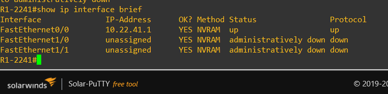

**Prueba 2 — Servidor DHCP:** el pool `LAN-2241` está configurado para la red `10.22.41.0/24`.

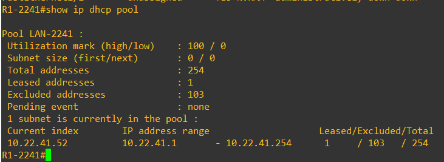

**Prueba 3 — Dirección entregada:** el router entregó una dirección del pool al servidor Zabbix.

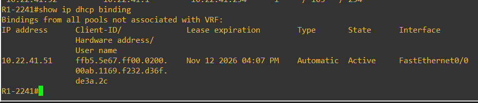

**Prueba 4 — SNMP de solo lectura:** la comunidad es `RO` y está limitada por la ACL 10.

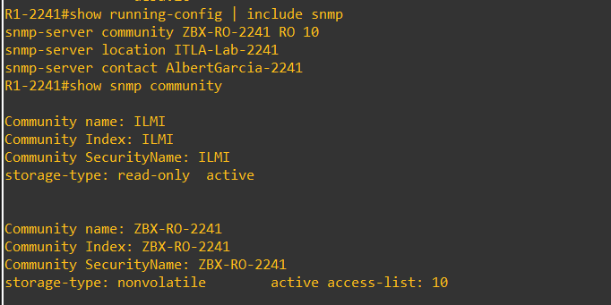

### Switch `SW1-2241`

**Prueba 5 — Direccionamiento:** la `Vlan1` tiene la IP `10.22.41.2`, está activa y hay conectividad con el router.

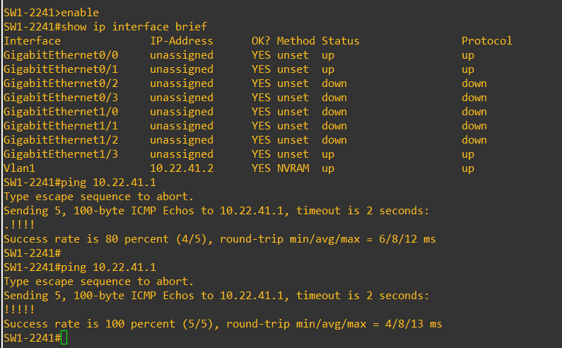

**Prueba 6 — SNMP de solo lectura:**

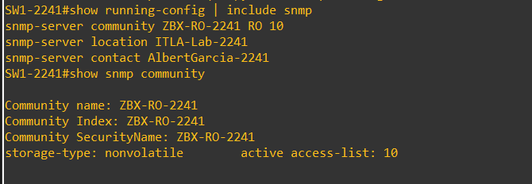

### Servidor `ZABBIX-2241`

**Prueba 7 — Cliente DHCP:** la interfaz `ens3` recibió una dirección `10.22.41.x` del router y hay conectividad con él.

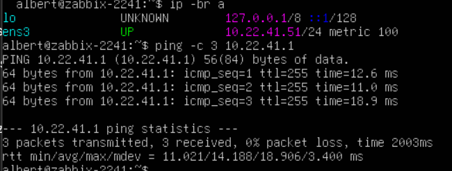

**Prueba 8 — Configuración DHCP:** `dhcp4: true` en netplan.

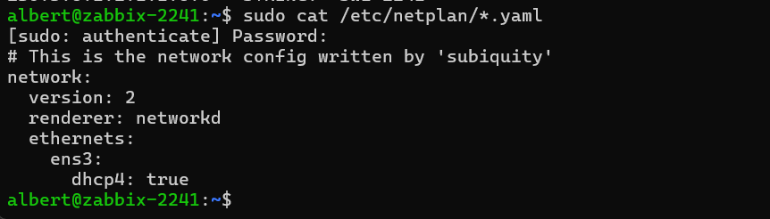

**Prueba 9 — SNMP hacia el router:** consulta de la descripción y del nombre del router desde el servidor.

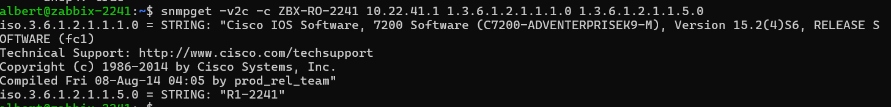

**Prueba 10 — SNMP hacia el switch:**

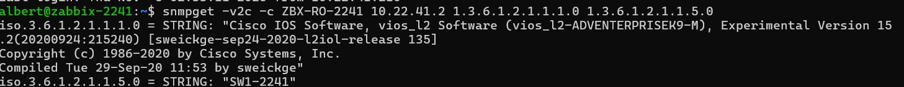

### Interfaz web de Zabbix

**Prueba 11 — Equipos monitoreados:** `R1-2241` y `SW1-2241` aparecen con la disponibilidad **SNMP** en verde.

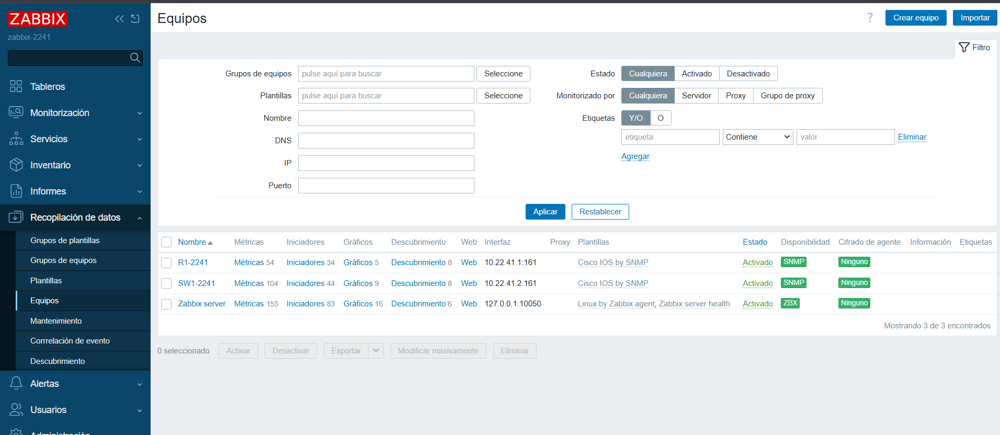

**Prueba 12 — Configuración de los equipos:** plantilla `Cisco IOS by SNMP` e interfaz SNMP del router y del switch.

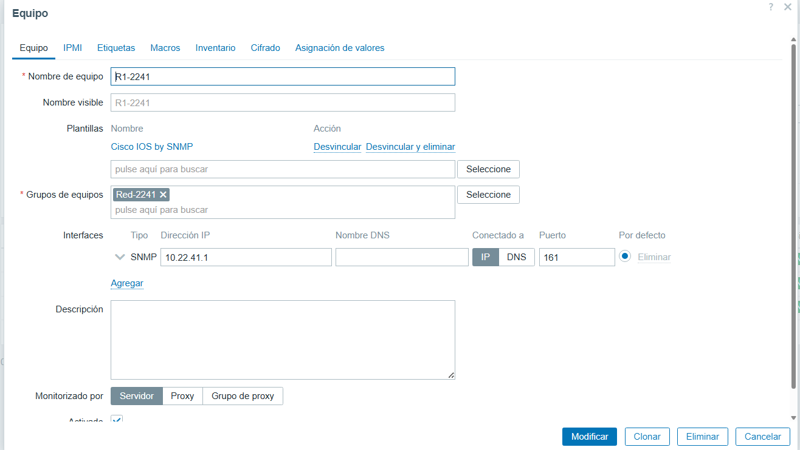

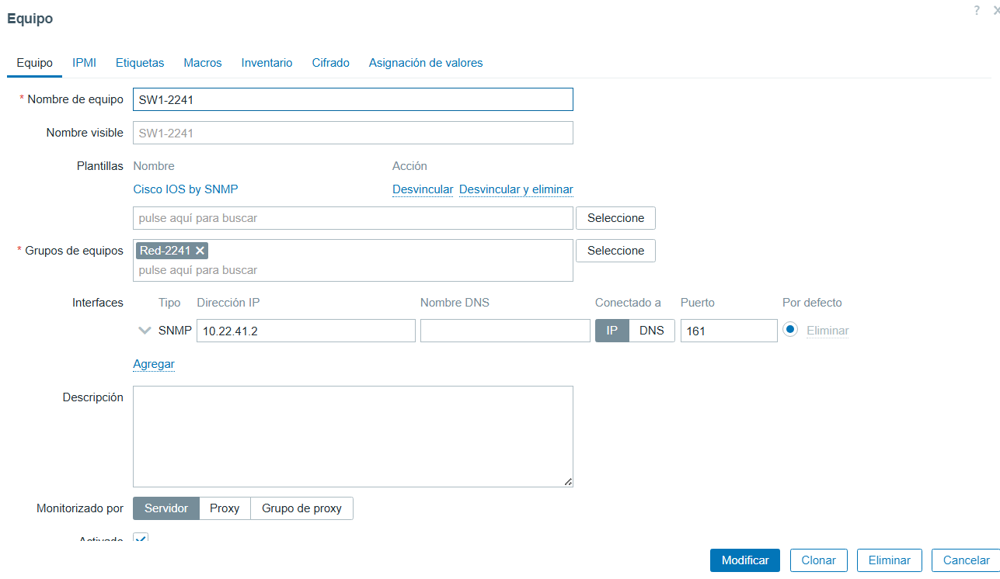

**Prueba 13 — Datos SNMP del router:** modelo del equipo, uso de CPU, memoria, temperatura y estado de las fuentes de poder.

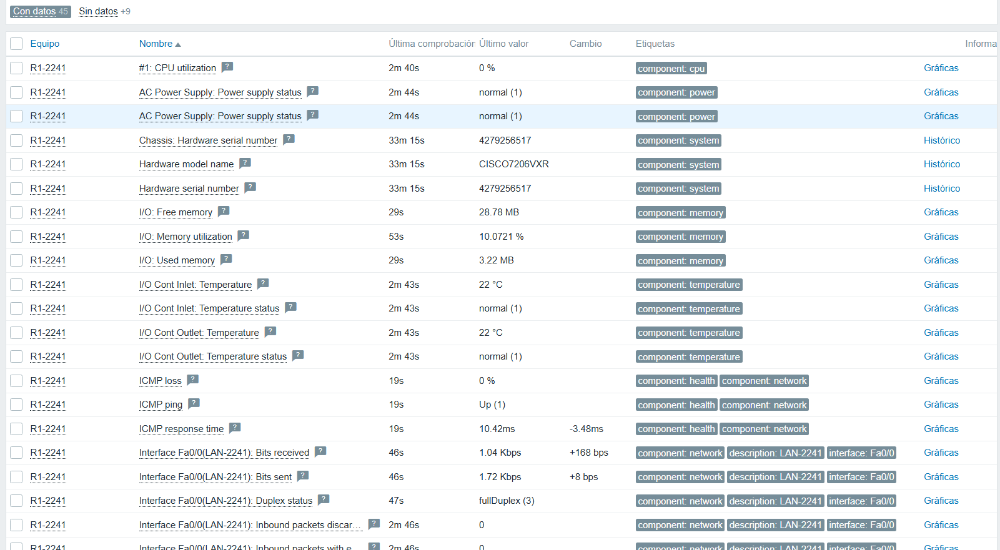

**Prueba 14 — Datos SNMP del switch:** ping, latencia y tráfico de las interfaces.

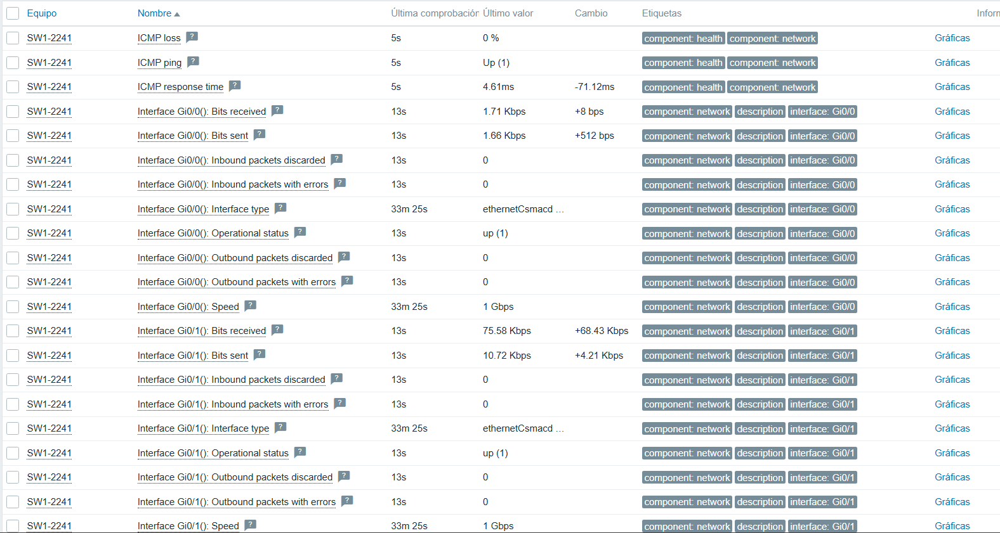

---

## 📜 Scripts

La carpeta [`scripts/`](scripts) contiene los comandos usados en cada fase. Las configuraciones finales completas de los equipos de red están en [`running-configs/`](running-configs).

| Script | Dónde se ejecuta | Qué contiene |
|---|---|---|
| [`01-R1-2241.txt`](scripts/01-R1-2241.txt) | Consola de `R1-2241` | Direccionamiento, servidor DHCP, ACL y SNMP de solo lectura del router |
| [`02-SW1-2241.txt`](scripts/02-SW1-2241.txt) | Consola de `SW1-2241` | Direccionamiento, ACL y SNMP de solo lectura del switch |
| [`03-zabbix-instalacion.txt`](scripts/03-zabbix-instalacion.txt) | Consola de `ZABBIX-2241` | Instalación de Zabbix, base de datos, PHP, Apache y archivo de configuración web |
| [`04-zabbix-red-y-pruebas.txt`](scripts/04-zabbix-red-y-pruebas.txt) | Consola de `ZABBIX-2241`, PowerShell de Windows y web de Zabbix | Cliente DHCP, IP de la PC de administración, pruebas SNMP y alta de equipos en Zabbix |

> Las contraseñas y la comunidad SNMP no se incluyen en este repositorio.

---

## 📁 Estructura del Repositorio

```
README.md
image/
├── 01-topologia.png
├── 02-adaptadores-vmware.png
├── 03-ip-windows.png
├── 04-r1-interfaces.png
├── 05-r1-dhcp-pool.png
├── 06-r1-dhcp-binding.png
├── 07-r1-snmp.png
├── 08-sw1-interfaces.png
├── 09-sw1-snmp.png
├── 10-zabbix-ip-dhcp.png
├── 11-zabbix-netplan.png
├── 12-zabbix-snmp-r1.png
├── 13-zabbix-snmp-sw1.png
├── 14-zabbix-equipos.png
├── 15-zabbix-config-r1.png
├── 16-zabbix-config-sw1.png
├── 17-zabbix-datos-r1.png
└── 18-zabbix-datos-sw1.png

running-configs/
├── R1-2241-running-config.txt
└── SW1-2241-running-config.txt

scripts/
├── 01-R1-2241.txt
├── 02-SW1-2241.txt
├── 03-zabbix-instalacion.txt
└── 04-zabbix-red-y-pruebas.txt
```
